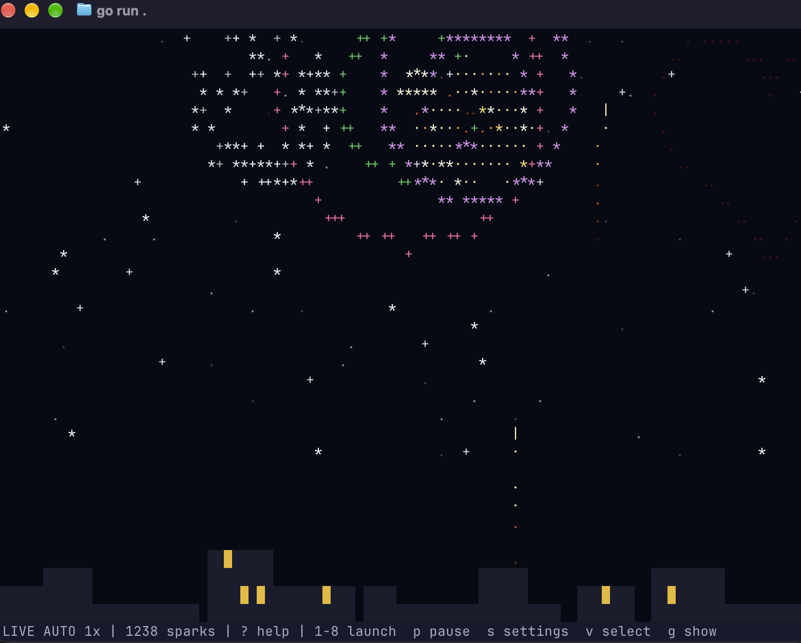

# Fireworks

The project idea came from the challenge `goship.hackclub.com` but i didn't submit the project over there cuz the event was over :(

a particle system show for your terminal that is built with Bubble Tea and Lip Gloss i got from idea generator :)

it has features to start firwork in terminal to start firworks. the inbuilt lip gloss and bubble tea helps to put the particle in the screen..

user can press button and fireworks is started

# to download

go to the website and

if windows:

click the download button to download to exe file and run it...

if macOS/linux:

go to the website and copy the command for macos/linux and paste it in your terminal and type `fireworks`.

# whats in it

- there is a freaking particle system for fireworks
- there is input system to detect what you enter
- a download mechanism for all major os (Mac,windows,linux)
- an automatic fireworks that sends fireworks randomly when pressed `a`

# did i use AI?

yes i used ai but only for debugging things that i couldn't solve

i asked ai how to make the thing i couldn't make but understood and wrote code my self (only some features) like complex math

# THANK YOU FOR READING :)
