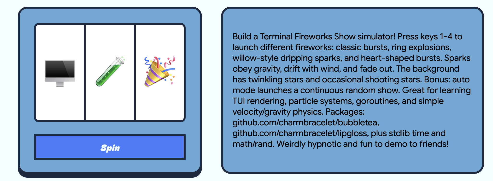

# Fireworks 

The project idea came from the challenge `goship.hackclub.com` 




A particle-system  show for your terminal that is  built with Bubble Tea and Lip Gloss.

## Run

```sh
go run .
```

## Controls

- `1`–`8`: launch individual firework shapes
- `space`: launch a random firework
- `a`: automatic launches
- `p`, `[`, `]`: pause and adjust simulation speed
- `v`, `g`: select and play a choreographed show
- `r`, `t`: record launches and replay the finished recording
- `w`, `o`: save or load the recording
- `s`, `i`, `?`: settings, session statistics, and help

Settings and recordings are stored in your operating system's user configuration directory.


